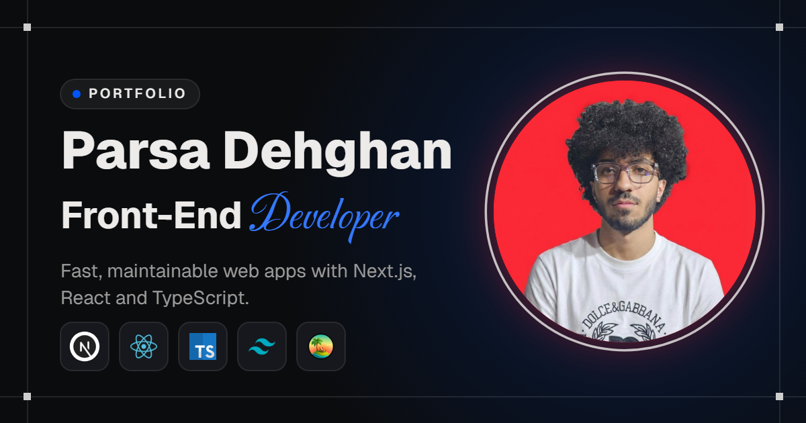

<picture>
  <source media="(prefers-color-scheme: dark)" srcset="./assets/github-banner-dark.png">
  <source media="(prefers-color-scheme: light)" srcset="./assets/github-banner-light.png">
  
</picture>

## About me

I'm a front-end developer based in Tehran with a background in software engineering.
I build fast, maintainable web apps with **Next.js**, **React** and **TypeScript** —
designed with care, built to last.

- 💼 Working full-time as a front-end developer
- 🤝 Open to freelance projects and new opportunities
- 🌱 Currently learning **C#** and **ASP.NET Core**
- 🎥 Sharing front-end tips on [YouTube](https://www.youtube.com/@frontendfresh)

## What I do

| | |
|---|---|
| **Front-End Development** | Production-ready interfaces with Next.js, React and TypeScript |
| **API Integration** | Reliable data layers with TanStack Query and Zustand — loading, error and empty states handled properly |
| **Pixel-Perfect UI** | Precise, responsive interfaces with Tailwind CSS and design systems |
| **Motion & Interaction** | Scroll-driven GSAP animations that keep pages smooth and fast |

## Tech stack

  

**Also:** TanStack Query · Zustand · GSAP · MUI · shadcn/ui

## Featured projects

| Project | Description | Stack | Links |
|---|---|---|---|
| **Portfolio** | My personal website with dark/light themes, scroll-driven animations and a token-based design system | Next.js · TypeScript · Tailwind · GSAP · Zustand | [Live](https://portfolioparsa.vercel.app) · [Code](https://github.com/parsa-farshah/portfolioparsa) |
| **Nike Shop** | E-commerce front-end with product listing and responsive layout | Next.js · TypeScript · Tailwind | [Live](https://nike-shop-next.vercel.app) · [Code](https://github.com/parsa-farshah/nikeShopNext) |
| **Fresh Swiper** | A lightweight, fully looped 3D slider library published on npm | JavaScript · npm | [Demo](https://parsa-farshah.github.io/fresh-swiper/) · [Code](https://github.com/parsa-farshah/fresh-swiper) |
| **Admin Panel** | Dashboard UI with charts, tables and a sidebar layout | JavaScript · Tailwind | [Code](https://github.com/parsa-farshah/admin-panel) |

## Let's connect

  
  
  
  
  
  

<picture>
  <source media="(prefers-color-scheme: dark)" srcset="https://raw.githubusercontent.com/parsa-farshah/parsa-farshah/output/pacman-contribution-graph-dark.svg">
  <source media="(prefers-color-scheme: light)" srcset="https://raw.githubusercontent.com/parsa-farshah/parsa-farshah/output/pacman-contribution-graph.svg">
  
</picture>
